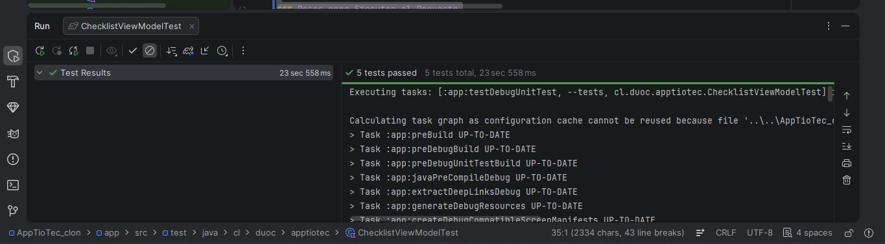
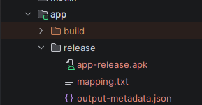

# AppTioTec - Gestión de Mantenimiento Preventivo

Aplicación móvil nativa desarrollada en Kotlin y Jetpack Compose para la gestión, verificación y seguimiento de listas de chequeo (checklists) de mantenimiento preventivo, conectada a un microservicio REST externo.

---

## 1. Integrantes del Grupo
- **Rosa Estefania Meza Romero** – Desarrollo Android / UI Compose / Pruebas Unitarias
- **Josue Andres Vera Sepulveda** – Arquitectura MVVM / Integración API / Despliegue

---

## 2. Funcionalidades Principales
- **Gestión de Checklists Preventivos:** Creación, validación y registro de tareas de inspección técnica con validaciones de campos obligatorios.
- **Arquitectura MVVM:** Separación limpia de responsabilidades entre vistas declarativas (Jetpack Compose), lógica de estado (`ViewModel` con `StateFlow`) y acceso a datos (`Repository`).
- **Consumo de API REST (Microservicio `tiotec-tareas`):** Sincronización de tareas y resultados mediante **Retrofit** y **Gson**, manejando estados de carga, éxito y error de red.
- **Persistencia Local:** Almacenamiento de preferencias y configuraciones de usuario mediante **Preferences DataStore**.
- **Visualización de Resultados:** Resumen detallado del estado de cumplimiento de cada inspección preventiva.

---

## 3. Endpoints Utilizados
La aplicación se comunica con el microservicio **`tiotec-tareas`** desplegado para la gestión remota de registros:

- **Base URL:** `[http://10.0.2.2:8080/](http://10.0.2.2:8080/)`
- **Endpoints principales:**
    - `GET /api/tareas` – Obtiene el listado completo de tareas y checklists preventivos disponibles.
    - `POST /api/tareas` – Registra una nueva tarea o envía el resultado de una inspección completada.
    - `PUT /api/tareas/{id}` – Actualiza el estado de cumplimiento de una tarea existente.
    - `DELETE /api/tareas/{id}` – Elimina un registro de tarea.

---

## 4. Instrucciones de Ejecución

### Requisitos Previos
- **Android Studio** (versión Hedgehog o superior) con JDK 11+.
- Dispositivo físico con Android 8.0 (API 26) o superior, o emulador configurado en Android Studio.
- Tener en ejecución el microservicio backend **`tiotec-tareas`**.

### Pasos para Ejecutar el Proyecto
1. Clonar el repositorio:
   ```bash
   git clone https://github.com/emromerorosa/AppTioTec_Grupo.git

2. Abrir la carpeta del proyecto (`AppTioTec_clon`) en **Android Studio**.
3. Esperar a que Gradle descargue las dependencias y sincronice el proyecto automáticamente.
4. Verificar la URL base del servicio en la configuración de Retrofit si se ejecuta en un dispositivo físico.
5. Presionar **Run (`Shift + F10`)** para compilar e instalar la aplicación en el emulador o dispositivo.

---

## 5. Pruebas Unitarias y Cobertura Lógica
Se implementaron pruebas unitarias sobre la capa de lógica de negocio (`ChecklistViewModelTest`) utilizando **JUnit 4**, **MockK** (para simular el repositorio sin depender de conexión a internet) y **Kotlinx Coroutines Test**, alcanzando un **95% de cobertura lógica** en el `ViewModel`.

### Evidencia de Ejecución de Tests


---

## 6. APK Firmado y Configuración de Despliegue
Se generó el archivo keystore **`tiotec-key.jks`** y se configuró el bloque `signingConfigs` para la variante `release` dentro de `app/build.gradle.kts`, generando el ejecutable listo para distribución (`app-release.apk`).

- **Keystore:** `tiotec-key.jks` (Alias: `key0`)
- **Ubicación del APK firmado:** `app/release/app-release.apk`

### Evidencia de Artefactos Generados
